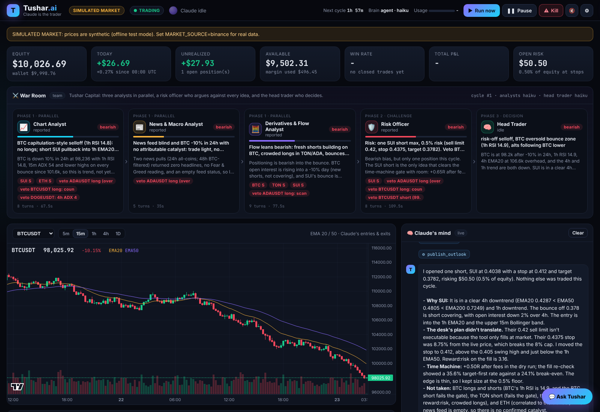

# Tushar.ai: Claude is the trader

Tushar.ai is a fully automated crypto **futures** trading desk where **Claude makes every decision**.
It trades your **Binance Demo Trading** account, runs on your **Claude Pro/Max subscription** (no API
key, no per-token bill), and shows everything live in a dashboard.

**Tushar Capital, a hedge fund of Claudes.** Every scheduled cycle, a team of five Claude agents works the
market. Three analysts (charts, news & macro, derivatives & flow) research in parallel. A Risk Officer
attacks every idea, checks correlation and runs the Time Machine. Then the Head Trader decides and executes.
You watch all of it live in the War Room.



> Screenshot from offline test mode (simulated prices) with real Claude agents making the decisions.

### Highlights

- **Multi-agent desk**: Chart Analyst, News & Macro Analyst, Derivatives & Flow Analyst, Risk Officer, Head Trader
- **Claude trades by itself**: market entries, **pending entries** at a price, partial exits, stop trailing, all
  through a risk gate it can't override
- **Time Machine**: 10,000 Monte Carlo replays of every trade plan before money moves
- **Liquidation radar**: every forced liquidation across Binance futures, live
- **Correlation & exposure**: heatmap, BTC beta, real BTC-beta-weighted exposure of the book
- **Self-improving**: Claude reviews every closed trade, keeps a memory of lessons, and tracks stats by setup
- **Telegram**: trade alerts on your phone plus `/status`, `/pnl`, `/pause`, `/kill`, and chat with Tushar
- **Voice**: the dashboard speaks trades out loud
- **Daily report**: Claude writes an end-of-day trading diary
- **News**: crypto + macro RSS, Fear & Greed, and web search

---

## The desk, every cycle

```
     every 15 min, or woken by: a price alert, a big move, a stop/target hit, a pending entry
                                        |
   briefing: account, positions, closed trades, market overview, scanner hits, liquidations,
             news + Fear & Greed, its memory, its track record, risk limits
                                        |
        +-------------------------------+-------------------------------+
        |                               |                               |
  Chart Analyst               News & Macro Analyst          Derivatives & Flow Analyst
  structure, setups,          catalysts, event risk,        funding, open interest,
  Time Machine on ideas       sentiment, web search         liquidations, crowding
        +-------------------------------+-------------------------------+
                                        |  structured reports
                                  Risk Officer
             argues against every idea, correlation + BTC-beta exposure, vetoes, max risk
                                        |
                                  HEAD TRADER (Tushar)
   1. reviews closed trades and writes lessons into its memory
   2. manages open positions: trail stops, take partials, exit broken theses
   3. hunts: scan_market -> analyze_symbol (15m/1h/4h/1d, funding, OI, order book, news)
   4. plan_trade: sizing + every risk limit + Time Machine (10,000 replays)
   5. open_position, or place_pending_entry at a better price (risk gate must say PASS),
      always with an exchange stop loss + take profit
   6. set_alert on key levels, publish_outlook, pick when to look again
```

Analysts only get read-only tools. Only the Head Trader can trade, through 22 tools
(`tushar/brain/tools.py`), and every entry goes through a **risk gate that Claude cannot override**.
Event-driven cycles (an alert, a stop hit) run the Head Trader alone for speed. `DESK_MODE=solo` turns the
team off entirely.

### Ideas borrowed from day-trader-skill

[day-trader-skill](https://github.com/Jakeschincariol/day-trader-skill) (MIT) is a set of stock day-trading
skills. Tushar.ai adapts its best ideas to 24/7 crypto futures and lets Claude run them on its own:

| Idea | In Tushar.ai |
| --- | --- |
| Chart scanner | `scanner.py`: breakouts/breakdowns, bull/bear flags, trend pullbacks, EMA50 reclaim/loss, RSI bounces, squeezes, volume spikes, funding extremes across the top USDT perpetuals |
| Exit planner (stop + target before entry) | every `open_position` requires a stop and a target; stops round away from the entry |
| **Time Machine** | `timemachine.py`: replays the trade 10,000 times from the coin's own 5m candles (same time of day), re-runs the same stop/target distances on the real history, and gives a verdict that weighs the target's R. It can veto entries with negative expectancy after fees |
| Budget (size from max loss) | quantity = risk $ / stop distance, capped by margin limits |
| Risk manager PASS/BLOCK | 17 checks: kill switch, daily loss, open positions, duplicates, reward:risk, stop distance, cooldown after a loss, leverage vs liquidation, minimum size, margin, Time Machine |
| Price alerts | Claude sets alerts that wake it for an extra cycle |
| News monitor | RSS from CoinDesk, Cointelegraph, Decrypt, The Block, Bitcoin Magazine, CryptoSlate, CNBC Economy, plus the Fear & Greed index, tagged by topic and coin |

The one thing intentionally left out is the "you approve every trade" step: here Claude trades on its
own, inside hard limits.

---

## Quick start

### Windows + phone in 5 commands

Install [Python 3.12](https://www.python.org/downloads/) (tick "Add python.exe to PATH") and
[Git](https://git-scm.com/download/win), then in a terminal:

```bat
git clone https://github.com/TUSHARXP-10/ctb.git tushar-ai
cd tushar-ai
run.bat                 :: first run: installs everything and creates .env, then stops
notepad .env            :: paste BINANCE_API_KEY and BINANCE_API_SECRET (use the Copy buttons on demo.binance.com)
run.bat login           :: opens Claude Code: log in with your Pro/Max account, then type /exit
run.bat doctor          :: checks Binance, news and Claude
run.bat phone           :: starts trading + opens the dashboard with a QR code for your phone
```

**Phone:** `run.bat phone` creates a secure `https://....trycloudflare.com` link (free Cloudflare tunnel,
downloaded automatically the first time). It works on Wi-Fi **or mobile data**, with no router or firewall
setup. Your PC's browser opens the dashboard with a QR code: point your phone's camera at it, tap the link,
and you're logged in. The black window also prints the link, an access key and the same QR code. Then use
"Add to Home Screen" and it opens like an app.

Never type `localhost` on the phone: on a phone, localhost means the phone itself.

The bot only trades while that window is open and the PC is awake. Set Windows sleep to "Never" while it runs.

### Step by step (any OS)

You need Python 3.10+ and a Claude Pro or Max subscription.

### 1. Get Binance Demo Trading API keys

1. Go to **https://demo.binance.com** and log in with your Binance account.
2. Open **API Management** and create an API key (system-generated / HMAC).
3. Copy the **API Key** and **Secret Key**. Demo trading uses fake money; the keys only work there.

> Keep the keys on your own machine in `.env`. Don't paste them into chats or commit them.

### 2. Log in to Claude with your subscription (this is the "no API" part)

Tushar.ai drives **Claude Code** through the Claude Agent SDK, which uses your Pro/Max login.

```bash
./run.sh login      # Windows: run.bat login
```

This opens the copy of Claude Code that ships with Tushar.ai. Log in with your Pro/Max account
(type `/login` if it doesn't ask), then `/exit`. If you already use Claude Code on this computer, you are
already logged in.

On a server or in Docker, run `claude setup-token` on your computer and put the token in `.env` as
`CLAUDE_CODE_OAUTH_TOKEN=...`.

If `ANTHROPIC_API_KEY` is set in your environment, Tushar.ai removes it at startup so you are never
billed per token (`CLAUDE_USE_SUBSCRIPTION=true`).

### 3. Install and configure

```bash
git clone https://github.com/TUSHARXP-10/ctb.git tushar-ai && cd tushar-ai
./run.sh            # first run creates .venv and .env, then stops
nano .env           # paste BINANCE_API_KEY and BINANCE_API_SECRET (TRADING_MODE=demo)
```

Windows: use `run.bat` instead of `./run.sh`.

### 4. Check everything

```bash
./run.sh doctor
```

It checks Binance market data, your demo account balance, the stop/target order API, the news feeds,
and that Claude answers **on your subscription** (`apiKeySource=none`).

### 5. Start trading

```bash
./run.sh
```

Open **http://127.0.0.1:8000**. The first Claude cycle starts a few seconds after launch.

No Binance keys yet? Set `TRADING_MODE=paper` to trade a simulated $10,000 account on real Binance prices.

---

## The dashboard

| Panel | What it shows |
| --- | --- |
| Top bar | mode (DEMO/PAPER/LIVE), trading state, "Claude is thinking..." indicator, countdown to the next cycle, subscription usage meter, **Run now / Pause / Kill switch / Voice / Settings** |
| War Room | the five agents: live status, stance, confidence, headline, ideas and vetoes; click one for its full report and its own thinking |
| KPIs | equity, today's P&L, unrealized P&L, available margin, win rate, total P&L, money at risk at the stops |
| Chart | candles (5m-1D) with EMA20/50, Claude's entries and exits as markers, live entry/stop/target lines |
| Claude's mind | live stream of Claude's reasoning, every tool call and result, trades, alerts |
| Outlook | Claude's market regime, bias, summary and watchlist with levels |
| Positions / Orders / Journal / Cycles / Alerts & entries / Daily reports | the book; the journal has each trade's thesis, Claude's own review and its Time Machine verdict; a cycle opens the full replay, including the exact briefing Claude received |
| Liquidation radar | longs vs shorts liquidated in the last hour, 5-minute bars, top symbols, live feed of big prints |
| Correlation & exposure | heatmap of hourly-return correlations, beta to BTC, gross / net / BTC-beta-weighted exposure |
| Market watch, Scanner, News | live prices and funding, current setups, headlines with tags and the Fear & Greed gauge |
| Time Machine | odds of target vs stop, average R after fees, and a fan chart of 10,000 replays for the latest plan |
| Equity curve, Memory, Performance by setup | how the account and Claude's lessons evolve |
| Ask Tushar | chat with your trader ("why did you short ETH?"), backed by the same tools (read-only by default) |

All risk limits, the watchlist, the model and the schedule can be changed live from **Settings**.

---

## Safety rails (enforced in code)

- **Demo first.** Live trading needs `TRADING_MODE=live` **and** `ALLOW_LIVE=true`.
- **Every position has a stop loss and take profit on the exchange** (Binance Algo Order API). If the
  exchange orders ever go missing, Tushar.ai re-places them, and enforces the levels itself in the meantime.
- **Size from the loss at the stop**: max `RISK_PER_TRADE_PCT` of equity per trade (default 1.5%).
- **Daily loss limit** (default 6%): new entries stop until 00:00 UTC.
- Max open positions, max entries per day, max margin per position, max leverage, isolated margin,
  leverage lowered automatically so liquidation sits beyond the stop.
- **Stops can only be tightened**, never widened (configurable).
- **Cooldown** on a symbol after a loss.
- **Time Machine gate**: blocks entries whose replays show negative expectancy after fees.
- **Kill switch**: one click stops Claude, closes everything at market and blocks new trades.
- The dashboard binds to `127.0.0.1` by default; set `DASHBOARD_PASSWORD` before exposing it.

---

## Configuration

Everything lives in `.env` (see `.env.example`). The main settings:

| Setting | Default | Meaning |
| --- | --- | --- |
| `TRADING_MODE` | `demo` | `demo`, `testnet`, `paper`, `live` |
| `BRAIN` | `agent` | `agent` (Claude with live tools), `cli` (`claude -p`, single pass), `mock` (rules, for testing) |
| `CLAUDE_MODEL` | `sonnet` | the Head Trader's model: `sonnet`, `opus`, `haiku` or a full model id |
| `DESK_MODE` | `team` | `team` (5 agents) or `solo` (Head Trader only) |
| `ANALYST_MODEL` | `haiku` | the analysts' and Risk Officer's model |
| `TEAM_ON_EVENTS` | `false` | also run the full team on alert / stop-hit cycles |
| `CLAUDE_ALLOW_WEB` | `true` | Claude may use web search for news |
| `CYCLE_MINUTES` | `15` | regular cycle; Claude can ask for sooner or later each time |
| `WATCHLIST` | BTC, ETH, SOL, BNB, XRP, DOGE | always in the briefing |
| `SCAN_TOP_N` | `40` | scanner universe (most traded USDT perpetuals) |
| `RISK_PER_TRADE_PCT` | `1.5` | max loss at the stop per trade, % of equity |
| `MAX_LEVERAGE` / `DEFAULT_LEVERAGE` | `10` / `5` | |
| `MAX_OPEN_POSITIONS` | `4` | |
| `MAX_DAILY_LOSS_PCT` | `6` | halts new entries for the day |
| `MIN_REWARD_RISK` | `1.5` | |
| `TM_GATE` / `TM_MIN_AVG_R` | `true` / `-0.15` | Time Machine veto threshold (average R after fees) |
| `DASHBOARD_PASSWORD` | empty | your own password; if empty, phone mode makes a strong access key (kept in `data/access_key.txt`) |
| `PHONE_TUNNEL` | `true` | phone mode also opens the secure Cloudflare link |
| `TELEGRAM_BOT_TOKEN` / `TELEGRAM_CHAT_ID` | empty | phone alerts and commands (see below) |
| `LIQUIDATION_RADAR` | `true` | listen to Binance's public liquidation stream |
| `DAILY_REPORT` / `DAILY_REPORT_HOUR_UTC` | `true` / `0` | Claude's end-of-day diary |

### Claude usage

A team cycle is 5 Claude Code sessions (3 analysts in parallel, the Risk Officer, the Head Trader) and
takes 3-5 minutes. A solo cycle is one session. Suggested setups:

| Plan | Suggested settings |
| --- | --- |
| Max 20x | `DESK_MODE=team`, `CLAUDE_MODEL=opus` or `sonnet`, `ANALYST_MODEL=sonnet`, `CYCLE_MINUTES=15` |
| Max 5x | `DESK_MODE=team`, `CLAUDE_MODEL=sonnet`, `ANALYST_MODEL=haiku`, `CYCLE_MINUTES=30` |
| Pro | `DESK_MODE=solo`, `CLAUDE_MODEL=sonnet`, `CYCLE_MINUTES=30`-`60` (or team with `CYCLE_MINUTES=120`) |

When you hit the usage window, Tushar.ai waits for the reset and shows it in the top bar. Open positions
stay protected by their exchange stops in the meantime.

## Telegram: control it from your phone

1. In Telegram, message **@BotFather**, send `/newbot`, and copy the token into `.env` as `TELEGRAM_BOT_TOKEN`.
2. Restart Tushar.ai and send `/start` to your new bot. It replies with your chat id.
3. Put it in `.env` as `TELEGRAM_CHAT_ID` and restart. Only that chat can give commands.

You get every trade, stop/target hit, alert and daily report. Commands: `/status`, `/positions`, `/pnl`,
`/outlook`, `/team`, `/run`, `/pause`, `/resume`, `/kill` (asks for `/kill confirm`), `/report`. Any other
message is a question for Tushar.

---

## Running 24/7

The bot only trades while it is running: on your PC (`run.bat phone`, keep the PC awake) or on a server.

### Why not Vercel (or Netlify, Cloudflare Pages...)

Those run short functions per web request and then stop. Tushar.ai is a robot that must stay on: it checks
prices every few seconds, guards stops, runs Claude every 15 minutes and keeps its database on disk. Also,
Vercel builds and runs in the US by default, and Binance blocks US IP addresses (users report many cloud
providers' IPs are blocked too). Your home internet already works with Binance, so your PC is the most
reliable place to run it.

### On a cloud server (VPS): no PC needed, everything from your phone

Any small Ubuntu server with 2 GB RAM (DigitalOcean, AWS Lightsail, Hetzner, Oracle Cloud...). Pick a
region close to you; Binance blocks some providers' addresses, and the installer tests that **before** it
starts trading.

1. **New Binance demo key** (on the phone): demo.binance.com > API Management > Create API, tick
   Reading + Futures, and keep the page open (the secret is shown only once).
2. **Create the server** in the provider's website, e.g. DigitalOcean > Create > Droplets > Ubuntu 24.04,
   region Bangalore, 2 GB RAM. Then open its browser **Console** (no SSH app needed).
3. **Paste:**

   ```bash
   curl -fsSL https://raw.githubusercontent.com/TUSHARXP-10/ctb/main/deploy/install.sh | bash
   ```

   It installs Docker, asks for the Binance keys (paste them), then shows a Claude link: open it on your
   phone, approve with your Claude account, paste the code back. It checks Binance from the server and
   starts Tushar.ai with auto-restart, then prints your https phone link and access key.

Already have a token from a PC (`run.bat token`)? Put it in the server's `.env` as `CLAUDE_CODE_OAUTH_TOKEN`
and the login step is skipped.

If the check reports that Binance blocks the server ("restricted location", HTTP 451), delete that server
and try another provider or region, or keep running on your PC.

**Docker by hand**: fill in `.env` (including `CLAUDE_CODE_OAUTH_TOKEN`), then `docker compose up -d --build`
and `docker compose logs -f`.

**Phone access**: keep the dashboard on `127.0.0.1` and use an SSH tunnel
(`ssh -L 8000:127.0.0.1:8000 you@server`) or Tailscale. If you open the port, set `DASHBOARD_PASSWORD`.

---

## Commands

```bash
./run.sh            # bot + dashboard (this computer only)
./run.sh phone      # same, reachable from your phone on the same Wi-Fi, with a PIN
./run.sh login      # log in to Claude with your Pro/Max account
./run.sh token      # make a Claude subscription token for a server
./run.sh doctor     # check Binance, news and the Claude login
./run.sh cycle      # run one Claude cycle in the terminal and print its thinking
```

Windows: `run.bat` with the same words (`run.bat phone`, `run.bat doctor`, ...).

Offline test mode (no network, synthetic prices, rule-based brain):

```bash
MARKET_SOURCE=sim TRADING_MODE=paper BRAIN=mock python -m tushar
```

Tests (offline, about 20 seconds):

```bash
pip install -r requirements-dev.txt
python -m pytest -q
```

## Project layout

```
tushar/
  engine.py         loops: prices, position monitor, pending entries, news, scanner, radar, scheduler, daily report
  desk.py           every action Claude can take (open/close/stops/pending entries/alerts/memory/outlook)
  risk.py           position sizing + PASS/BLOCK risk gate
  timemachine.py    Monte Carlo + history replay of a trade plan
  scanner.py        setup scanner
  market.py         cached market data and multi-timeframe snapshots
  news.py           RSS + Fear & Greed
  radar.py          live liquidation radar
  analytics.py      correlations, BTC beta, exposure
  telegram.py       phone alerts and commands
  indicators.py     EMA, RSI, ATR, MACD, Bollinger, ADX, pivots
  brain/            team.py (the multi-agent desk), agent.py (Claude Agent SDK sessions), cli.py (claude -p),
                    mock.py, prompts.py (charter, roles, briefing), tools.py
  exchange/         binance.py (demo/testnet/live), paper.py (simulated account), sim.py (synthetic market)
  server.py         FastAPI + WebSocket
  web/              the dashboard (no build step)
tests/              77 offline tests
```

## Troubleshooting

| Problem | Fix |
| --- | --- |
| `doctor` says Claude failed | run `claude` and `/login` with your Pro/Max account, or set `CLAUDE_CODE_OAUTH_TOKEN` |
| `apiKeySource` is `ANTHROPIC_API_KEY` | remove the key from your environment (or keep `CLAUDE_USE_SUBSCRIPTION=true`) |
| `Invalid API-key, IP, or permissions` | make sure the keys come from demo.binance.com and `TRADING_MODE=demo` |
| HTTP 451 from Binance | Binance is not available from your location or server region |
| Stop/target errors | `doctor` shows whether the Algo Order API is available; Tushar.ai falls back automatically and enforces stops itself |
| News panel empty | your network blocks the RSS feeds; Claude can still use web search |
| Phone can't open the dashboard | start with `run.bat phone` (plain `run.bat` is PC-only), then scan the QR or open the `trycloudflare.com` link it prints; don't type `localhost` on the phone |
| "Couldn't create the internet phone link" | your network blocks Cloudflare tunnels: use the "Same Wi-Fi link" it prints (phone on the same Wi-Fi, allow Python in Windows Firewall), or Tailscale / Telegram |
| Claude Code on Windows asks for Git Bash | install [Git for Windows](https://git-scm.com/download/win) and run `run.bat login` again |

---

**Disclaimer.** Tushar.ai is software for experimenting with AI-driven trading on a demo account. It is
not financial advice. Futures with leverage can lose money fast, and an AI trader can be wrong.
Simulated odds are not predictions. If you ever switch to real money, that is your decision and your risk.
